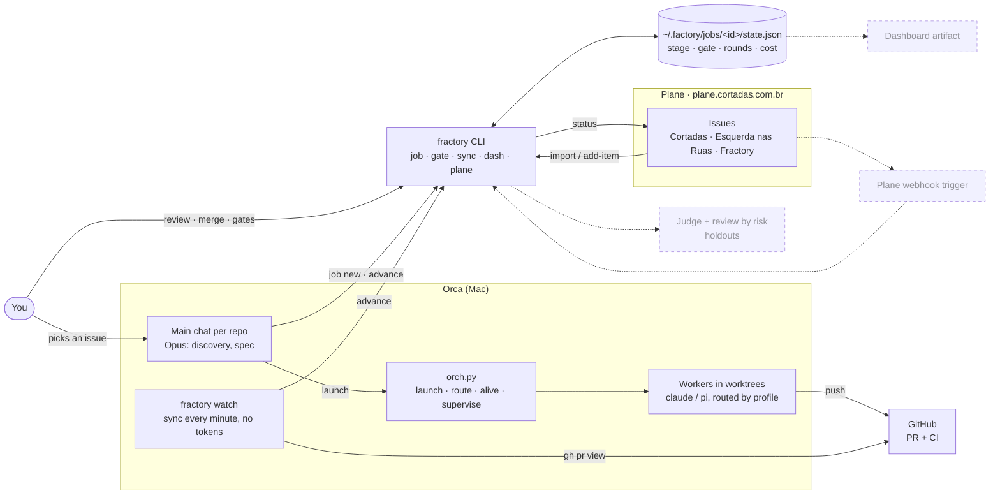

<p align="center">
  <picture>
    <source media="(prefers-color-scheme: dark)" srcset="assets/logo-dark.svg">
    
  </picture>
</p>

# Fractory

Engine and control plane of the agent factory on Orca. Code decides a job's stage, transitions,
gates and escalation; a model only works inside a stage.

Design: [Fractory — design da versão final](https://claude.ai/artifact/MaZLMg6zhgk1niVf49h5Fc).
This repo is **v0 (engine)**: the job state machine, the CLI, the Plane adapter and the import of open
specs. Building still runs through `orch.py` (passthrough, behaviour unchanged).

## Run

```sh
python3 -m fractory --help          # no install needed, stdlib only (Python 3.12+)
pipx install -e .                    # optional: a `fractory` command on PATH
python3 -m unittest discover -s tests -t .
```

## How the pieces fit today

Solid boxes run now (v0); dashed ones are planned (v1/v2).



## Using it in Orca

A job's life today, with the manual steps v1 will automate marked *(manual)*.

**Once**

1. Plane token in the Keychain: `security add-generic-password -s fractory-plane -a plane -w`.
2. `pipx install -e ~/Factory/Fractory` so `fractory` works in every Orca terminal.
3. Leave one Orca terminal running `fractory watch`. It moves jobs on CI and merge events and keeps the
   Plane issues in step.

**Per task**, from the repo's main chat in Orca (ask Claude in plain words, e.g. *"start a fractory
job for the Plane issue X"*; these are the commands it runs):

| Step | Command | Who |
| --- | --- | --- |
| 1. Pick the work | an issue in Plane, or `fractory plane add-item --project <id> --title …` | you |
| 2. Open the job | `fractory job new --repo . --title … --stage build --tracker plane --project <id> --ref <issue>` | main |
| 3. Give it a worktree | `orca worktree create --repo path:. --name <branch> --no-parent` | main |
| 4. Build | a worker via `fractory orch launch …`, or the main itself in that worktree | worker |
| 5. Open the PR and link it | `gh pr create`, then `fractory job link <id> --worktree … --pr <n>` and `fractory job advance <id> built` | worker / main |
| 6. Checks | nothing: `fractory watch` sees CI; red goes back to build, green moves on to review | watch |
| 7. Review and verdict *(manual)* | `fractory job advance <id> reviewed`, then `approved` or `rejected` | you / main |
| 8. Merge | merge the PR on GitHub (Able repos: open the draft PR instead) | you |
| 9. Done | nothing: `fractory watch` sees the merge, finishes the job and moves the Plane issue to Done | watch |

**Day to day**

```sh
fractory job list            # what is open and where it stands
fractory gate list           # what waits on you (judge rounds, cost, scope)
fractory gate resolve <id> continue --note "…"    # or cancel
fractory job status <id>     # history, links, next allowed events
fractory dash                # JSON for the dashboard
```

## Jobs

State lives outside every repo, in `$FACTORY_HOME/jobs/<id>/` (default `~/.factory`):
`state.json`, plus `holdout/` for acceptance scenarios the build never sees.

```
discovery --scoped--> spec --planned--> build --built--> checks --green--> review --reviewed--> judge
                                          ^                 |red                                  |approved
                                          +-----------------+------------<rejected----------------+
judge --approved--> ship --merged (internal) | draft_pr (Able)--> done          any --cancel--> cancelled
```

| Rule | Where |
| --- | --- |
| Same check red 2x → `escalate_model` (step up via `orch.py route --escalate-from`) | `state.apply_event` |
| 2 judge rejections → gate `judge_rounds`; events refused until resolved | `state.apply_event` |
| Spend over budget (default US$ 50) → gate `cost` | `state.add_cost` |
| Able repos (under `~/Factory/Able`) end in `draft_pr`; internal ones in `merged` | `state.apply_event`, `store.repo_kind` |

```sh
fractory job new --repo ~/Factory/Esquerdalha/cortadas --title "Chat no Plane"
fractory job advance cortadas-0001 scoped
fractory job link cortadas-0001 --worktree spec-x --terminal term_… --profile backend
fractory job advance cortadas-0001 red --check lint
fractory job cost cortadas-0001 3.20
fractory gate list
fractory gate resolve cortadas-0001 continue --note "spec ajustada"
fractory sync                       # advance jobs from their PR and CI, mirror to Plane
fractory dash --out /tmp/dash.json
fractory orch alive term_…          # everything orch.py does, unchanged
```

## Plane

API key: `$PLANE_API_KEY`, or the Keychain item `fractory-plane`
(`security add-generic-password -s fractory-plane -a plane -w`). Create the key in Plane under
Profile settings → Personal access tokens.

```sh
fractory plane projects
fractory plane import-specs --repo ~/Factory/Esquerdalha/cortadas --project <id>           # dry run
fractory plane import-specs --repo ~/Factory/Esquerdalha/cortadas --project <id> --apply   # create
```

```sh
fractory plane create-project --name Fractory --identifier FRACTORY
fractory plane add-item --project <id> --title "…" --body "markdown" --status ready
fractory job new --repo DIR --title T --tracker plane --project <id> --ref <issue id>
```

Only open specs (`draft`, `blocked`, `ready`, `in-progress`, `in-review`) are imported; done ones stay in
the repo as frozen history. Each issue carries `external_id` = the spec id, so a second run reports
`exists` instead of duplicating.

## Next (v1)

Holdout verifier, risk score and review by risk, Judge with a fixed rubric, `fractory watch` under
launchd, Orca native gates, and retiring the always-on orchestrator. The roadmap lives in the Plane
project FRACTORY.
