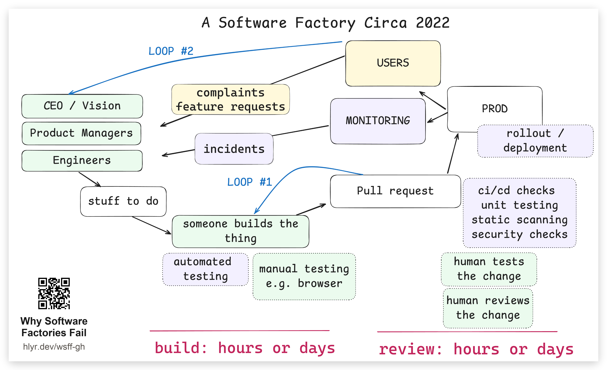
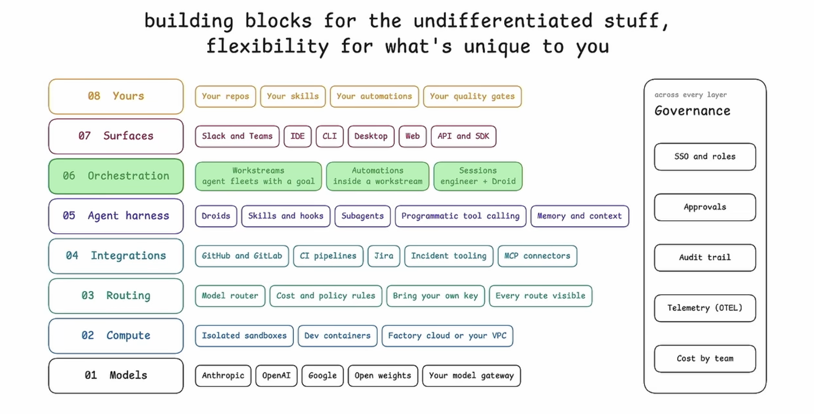

# Fractory TUI

## Description

I'm Pedro Frattezi, I'm a software engineer and I want to build my own AI Factory, joining open source tech + best practices for it. I will use this document to describe exactly this software shape and architecture

## Use flow

The typical use flow for the Fractory TUI involves interacting with agents, managing tasks, and leveraging the defined skills and external tooling to efficiently run the AI Factory.
My main challange so far has being deciding good points to insert human on the loop. Also define reliable triggers for automated work, and I need help on this.

In general:

- Start by defining the tasks and goals for the AI Factory.
- From tasks and definition, agents will be executed with different models, contexts injected and appropriate skills applied to achieve the desired outcomes.
- Insert human oversight at critical decision points to maintain quality and reliability. Agent Manager should be the main interaction interface for human involvement. or documentation should be used to track and guide human interventions.
- Document all decisions and changes to maintain a clear record of the AI Factory's operations.
- Two disctinct behaviors and ways to behave, for work, I have a flow with other devs in the review flow, and a more complex/critical env, personally, I maintain projects which I have no issue on pushing things and moving fast.

# Technologies

### UI

The user interface for the AI Factory, allowing interaction with agents and management of tasks.

- [Agent Manager](https://github.com/wainmann/agent-manager)

### Backend

Use sandcastle to securely run untrusted JavaScript code in a sandboxed environment and define flows for executing tasks.

- [SandCastle](https://github.com/mattpocock/sandcastle)

### Harness

- [AI Memory](https://github.com/akitaonrails/ai-memory)

### External tooling

What other software will be used on day to day tasks by me.

- Browser: Chrome
- Text/Code editor: Vs Code
- Terminal: [Ghostty](https://ghostty.org/)

### Frameworks and Guidelines

- [Slop Manifesto](https://www.slopmanifesto.com/)
- [Why Software Factories Fail](https://github.com/humanlayer/advanced-context-engineering-for-coding-agents/blob/main/wsff.md)

  
  

### Skills

Skills to base of, write our own implementations related to our fractory, but those are "functionalities" i want when running the factory

- [Grill me with docs](https://github.com/mattpocock/skills/blob/main/skills/engineering/grill-with-docs/SKILL.md)
- [To Spec](https://github.com/mattpocock/skills/blob/main/skills/engineering/to-spec/SKILL.md)
- [To tickets](https://github.com/mattpocock/skills/blob/main/skills/engineering/to-tickets/SKILL.md)
- [Research](https://github.com/mattpocock/skills/blob/main/skills/engineering/research/SKILL.md)
- [Handoff](https://github.com/mattpocock/skills/blob/main/skills/productivity/handoff/SKILL.md)

---

## My general guidelines

- Follow best practices for software factories.
- Do not integrate Agent Manager into the Fractory, but i want to modify and specialize agent manager for my own needs and fractory views.
- Always based on zero token architecture.
- Worktrees are heavy, we should keep cleanups and manage them efficiently.
- Always document architectural decisions and changes to maintain clarity and traceability.
- In general, I should be able to use this software factory by acessing claude on a terminal, and loading my config.