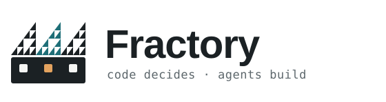
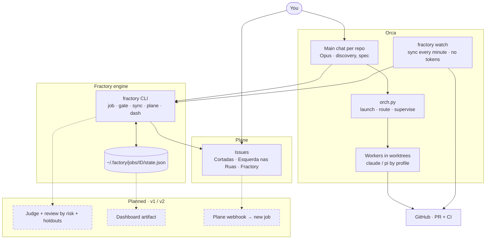

<p align="center">
  <picture>
    <source media="(prefers-color-scheme: dark)" srcset="assets/logo-dark.svg">
    
  </picture>
</p>

# Fractory

Engine and control plane of the agent factory on Orca. Code decides a job's stage, transitions,
gates and escalation; a model only works inside a stage.

Design: [Fractory — design da versão final](https://claude.ai/artifact/MaZLMg6zhgk1niVf49h5Fc).
This repo is **v0 (engine)**: the job state machine, the CLI, the Plane adapter and the import of open
specs. Building still runs through `orch.py` (passthrough, behaviour unchanged).

## Run

```sh
python3 -m fractory --help          # no install needed, stdlib only (Python 3.12+)
pipx install -e .                    # optional: a `fractory` command on PATH
python3 -m unittest discover -s tests -t .
```

## How the pieces fit today

Everything outside *Planned* runs today (v0). You pick work in Plane and talk to the repo's main chat; the CLI keeps each job's state; `fractory watch` moves jobs on CI and merges and updates Plane.



## Using it in Orca

A job's life today, with the manual steps v1 will automate marked *(manual)*.

**Once**

1. Plane token in the Keychain: `security add-generic-password -s fractory-plane -a plane -w`.
2. `pipx install -e ~/Factory/Fractory` so `fractory` works in every Orca terminal.
3. `fractory watch --install`: a LaunchAgent keeps `watch` running across reboots (log:
   `~/.factory/watch.log`). It moves jobs on CI and merge events and keeps the Plane issues in step.
4. `fractory serve --install`: a LaunchAgent keeps the board up at http://127.0.0.1:8777 (log:
   `~/.factory/serve.log`; `--port N` to change it).
   Run both installs from an Orca terminal: they copy `ORCA_USER_DATA_PATH` and `ORCA_CLI_COMMAND` into the
   agent, without which `orca` answers `runtime_unavailable` under launchd and the rework hook cannot reach
   workers (the install warns when it is unset).
5. Optional, for internal repos: `echo 'auto_merge = true' >> ~/.factory/config.toml`. Then `watch` merges
   the PR of every approved internal job once its CI is green. Able jobs never auto-merge.
   Only low-risk diffs merge; a sensitive path or a big diff (>400 lines, >12 files) opens the gate `merge_review`. Tune in a `[risk]` table; `no_merge_review = ["~/path/to/repo"]` lets a dev-only repo merge at any risk (still recorded).
   A repo can add its own rules in `fractory.toml` at its root (read from the local checkout, so a PR cannot loosen its own limits before merging): `[risk]` `sensitive = ["billing/", "seed"]` extends the defaults (`auth`, `secret`, `migrat`, `schema`, `infra/`, `.github/`, ...), never replaces them; `max_lines` / `max_files` override the limits. No file, no change.

**Per task**, from the repo's main chat in Orca (ask Claude in plain words, e.g. *"start a fractory
job for the Plane issue X"*; these are the commands it runs):

| Step | Command | Who |
| --- | --- | --- |
| 1. Pick the work | an issue in Plane, or `fractory plane add-item --project <id> --title …` | you |
| 2–4. Job, worktree, worker | `fractory launch --repo . --issue <plane issue> --project <id> --brief FILE` (title from the issue; run id from `orca_run` in `config.toml` or `--run`; `--dry-run` shows the steps; right after the worktree is created and before the worker starts it installs a push guard in that worktree only (`guard.py`, step 4b; `watch` relaunches and profile escalations install it again): a `pre-push` hook that refuses pushes to `refs/heads/main` and `refs/heads/master`, so a worker must push its branch and open a PR; the repo's own hooks still run, and the main checkout's config is never changed; once the worker runs, it adds the owner to the card (keeping other assignees) and sets the start date if empty; first checks the brief against the card and stops if it goes beyond it, unless `--force`) | main |
| 1b. Let the factory take it | label the card `fractory` (who) and move it to Todo (when); `fractory intake` launches only Todo cards, Backlog ones are parked | you / intake |
| 5. Open the PR and link it | `gh pr create`, then `fractory job link <id> --worktree … --pr <n>` and `fractory job advance <id> built` | worker / main |
| 6. Checks | nothing: `fractory watch` sees CI; red goes back to build, green moves on to review | watch |
| 6b. Rework | nothing: when a job goes back to `build` (CI red, Judge rejected) the reasons are typed into the worker's terminal (`links.terminal`) through `orch.py nudge`, and the history logs `rework_sent`; when the terminal no longer exists in Orca (`orca terminal list`, e.g. after a reboot) `sync`/`watch` starts a new worker in the job's worktree (same profile, the brief plus a resume note, `links.terminal` updated, `relaunched` event, at most once per hour per job), and a rework nudge to a dead terminal relaunches instead of gating; with no terminal, no relaunch possible or a failed nudge a `rework_needed` gate opens, and `fractory job advance <id> built` closes an open `rework_needed` gate (the worker did the rework) instead of refusing. A rejection that opens `judge_rounds` waits for you; resolving it with `continue` (CLI or card Done) types the last rejected note into the worker's terminal and logs `rework_sent` (no terminal: `rework_needed`). A build with a PR, quiet for longer than the `[stuck]` build threshold, whose terminal is idle gets one nudge (`nudged` event) from `sync`; the next time it opens `rework_needed`. A conflicting PR (`mergeable = CONFLICTING`) is never merged: the worker gets a rework message once (merge origin/main, resolve, push) and the history logs `conflict_sent`; with no reachable worker a `merge_conflict` gate opens | watch / judge |
| 7. Review and verdict | `fractory judge <id>` (Opus vs the Plane issue, fixed rubric; generated files are replaced by a one-line stub before the 60,000-char size limit and listed in the prompt, see [Generated files](#generated-files-in-the-judge); also reads `$FACTORY_HOME/jobs/<id>/brief.md` when present, default `~/.factory`, and a brief over 20,000 chars opens a `judge_error` gate); the model runs in a temporary git worktree of the PR head with read-only tools (`Read,Grep,Glob`) so it can read files outside the diff, and the rubric makes a rejection name the file and line it checked; the PR's CI results go into the prompt, and a rejection whose every reason the model also lists as `unverified` becomes `approved` only when all CI checks are green (the guesses stay as notes in the comment), otherwise it stays rejected; with `auto_judge = true` in `config.toml`, `watch` runs it for every job in review. By hand: `fractory job advance <id> reviewed`, then `approved` or `rejected` | judge / you |
| 8. Merge | internal with `auto_merge`: nothing, `watch` merges on green CI (not while the PR conflicts with main, see 6b); otherwise merge on GitHub (Able: open the draft PR) | watch / you |
| 9. Done | nothing: `fractory watch` sees the merge, finishes the job and moves the Plane issue to Done, then cleans up once: stops or releases the worker's dispatch, closes the job worktree's terminals, removes the worktree (only if clean and merged; otherwise keeps it and records `cleanup_skipped`) and deletes the local branch | watch |

**Day to day**

```sh
fractory job list            # what is open and where it stands
fractory gate list           # what waits on you (judge rounds, cost, scope)
fractory gate resolve <id> continue --note "…"    # or cancel
```

Every gate on a job with a Plane tracker also becomes a card in the same project (`Needs you: <gate> · <job title>`,
label `humano`, state Todo, assignee `plane_assignee` from `config.toml`), created by `watch`/`sync`. Move the card to
Done to continue the job or to Cancelled to cancel it; comments on the card are copied into the decision note.
`gate resolve` on the CLI moves the card to Done.

```sh
fractory job status <id>     # history, links, next allowed events
fractory dash                # JSON for the dashboard
```

## Jobs

State lives outside every repo, in `$FACTORY_HOME/jobs/<id>/` (default `~/.factory`):
`state.json`, plus `holdout/` for acceptance scenarios the build never sees.

The factory also writes `$FACTORY_HOME/hooks/`: the shared hook scripts that the push guard points each worker worktree at (via `git config --worktree core.hooksPath`). Each one runs the repo's own hook of the same name; `pre-push` first refuses `main`/`master`. They are rewritten on every launch.

```
discovery --scoped--> spec --planned--> build --built--> checks --green--> review --reviewed--> judge
                                          ^                 |red                                  |approved
                                          +-----------------+------------<rejected----------------+
judge --approved--> ship --merged (internal) | draft_pr (Able)--> done          any --cancel--> cancelled
```

| Rule | Where |
| --- | --- |
| Same check red 2x → `escalate_model` (step up via `orch.py route --escalate-from`) | `state.apply_event` |
| 2 judge rejections → gate `judge_rounds`; events refused until resolved | `state.apply_event` |
| Spend over budget (default US$ 50) → gate `cost` | `state.add_cost` |
| Able repos (under `~/Factory/Able`) end in `draft_pr`; internal ones in `merged` | `state.apply_event`, `store.repo_kind` |

```sh
fractory job new --repo ~/Factory/Esquerdalha/cortadas --title "Chat no Plane"
fractory job advance cortadas-0001 scoped   # a stage change also moves the Plane card, like sync does
fractory job link cortadas-0001 --worktree spec-x --terminal term_… --profile backend
fractory job advance cortadas-0001 red --check lint
fractory job cost cortadas-0001 3.20
fractory gate list
fractory gate resolve cortadas-0001 continue --note "spec ajustada"
fractory judge cortadas-0001        # verdict on the PR diff vs the Plane issue; moves the job, comments on PR and issue
fractory sync                       # advance jobs from their PR and CI, mirror to Plane
fractory watch                      # sync every 60 s until stopped (--every S, --rounds N); each cycle also moves the Plane card of every done job to Done (cancelled → Cancelled) when it is not there yet, one line per fix, from one cached issue listing per project
fractory watch --install            # the same, as a LaunchAgent that survives reboots
fractory cleanup [--job ID] [--dry-run]  # close a finished job's terminals, worktree and branch in Orca (also retries kept ones)
                                    # watch and serve exit when main moves, launchd restarts them (watch: --no-reload)
fractory dash --out /tmp/dash.json
fractory serve                      # the live board at http://127.0.0.1:8777
fractory orch alive term_…          # everything orch.py does, unchanged
```

## Web view

```sh
fractory serve [--port 8777]          # binds 127.0.0.1 only
```

The board opens on what needs attention now (the per-stage kanban, detail panel and activity feed are gone
until DB05). Page text is Portuguese. Seven parts:

- **Health strip:** watch alive or stopped, last cycle (`há 40 s · 12 s`: time since it ended, how long it took),
  WIP `n / max_parallel_jobs`, open gates, stuck jobs, Plane rate-limit backoffs of the last cycle and the code
  sha. Problems carry an icon (✕ / ⚠) as well as colour.
- **Precisa de você:** open gates, oldest first: title, repo, the gate reason in plain Portuguese (e.g.
  `merge_review` → "Revisar merge: mexe em migração"), age, and links to the Plane card and the PR.
- **Parado:** jobs stuck in a stage past the `[stuck]` limits, with reason, age, and links to the card and PR plus
  the worker terminal handle. Gate-stuck jobs are not repeated here.
- **Em andamento:** open jobs grouped by repo, each with a horizontal build → checks → review → judge → ship
  timeline (time per stage from `/api/metrics` `stage_minutes`; the current stage is highlighted with its age).
  Small markers show Judge rework rounds (↺) and conflicts sent to the worker (⚡). Click a job to open the drawer.
- **Fila:** per Plane project, the next cards with the decision in Portuguese: "vai começar", "espera MC02",
  "limite de N jobs", "em Backlog", "falhou ao iniciar: …".
- **Concluídos** (collapsed): the last 20 merged jobs with lead time.
- **Job drawer:** the Judge verdicts and the full event history (time, event, stage, note) from
  `GET /api/jobs/<id>`, with links to the card, the PR and the worker terminal.

- **Como estamos trabalhando:** a 7 / 30 day toggle over `/api/metrics?window=`: merges per day (inline SVG stacked
  bars, repos filterable from the legend), lead time median and p90, median time per stage, Judge first-pass rate,
  mean rework rounds, CI red rate, conflicts, gates opened by reason with median time to resolve, and cost per repo
  ("sem dados" when zero). Tap or hover a number for a one-line explanation. Charts carry `<title>`/`<desc>` and
  print their values as text; colours follow light and dark.

The page reads `GET /api/health` (strip), `GET /api/metrics` (`stuck`, each with `reason` and its Portuguese `reason_pt`; `stage_minutes` for the timelines), `GET /api/queue` (Fila), `GET /api/jobs/<id>` (drawer) and `GET /api/jobs`, and follows
`state.json` changes through Server-Sent Events (`/api/events`). `/api/jobs` carries, per job, `pr_url`,
`tracker_url`, `stuck`, `terminal`, `gate_detail` (raw, shown behind a "detalhe" toggle), `gate_text` (the Portuguese sentence from `fractory/pt.py`), `gate_opened_at`, `gate_card_url`, `stage_age_min` (minutes in the current stage), `conflicts` (conflict_sent events), `merged_at` and `lead_min` (creation to merge; null until merged), plus a top-level
`wip {open, max}` (`max` is `max_parallel_jobs`, default 3). Read-only, one self-contained HTML file, no
build step. `GET /api/activity?limit=50` (clamped to 1..200) still exists for a later board part.

Factory health and the intake queue come from two snapshots the watch leaves in `$FACTORY_HOME`, so the
board never calls Plane: `heartbeat.json` (written atomically at the end of every watch cycle: cycle start,
end and duration, cycle count, pid, start time, code sha, error counts, Plane rate-limit backoffs, last 10
error lines) and `queue.json` (written by every intake run: per project, each labelled card with its
decision: `launched`, `waits_for` (unmet dependencies), `max_parallel`, `parked`, `has_job` or
`launch_failed` with the error). `GET /api/health` serves the heartbeat plus `alive` (the last cycle ended
less than 3× `--every` ago) and `GET /api/queue` serves the queue with a Portuguese `decision_text` on each card (cards already `has_job` are dropped); both answer 200 `{"missing": true}` until
the file exists.

`GET /api/metrics?window=7|30` (default 7) computes, from the job histories (`fractory/metrics.py`): time per
stage and current stage age per job, `stuck` items (each with a one-line reason), flow (lead time median and
p90 per repo and overall, throughput per day, `merged_per_day` rows for the chart, WIP), `stage_summary` (median minutes per stage), quality (Judge first-pass rate, mean rework rounds, CI red
rate, conflicts sent, gates opened by reason with median time to resolve) and cost per repo. Each item of
`/api/jobs` also carries `stuck` (`null` when the job is moving). A job is stuck when its current stage is
older than a per-stage limit, or when it has an open gate (any age, "waiting on you"). Limits in minutes,
overridable in `config.toml` (the `build` limit also decides when `sync` nudges an idle build, see 6b):

```toml
[stuck]   # defaults
build = 60
checks = 30
review = 20
judge = 20
ship = 15
```

## Plane

API key: `$PLANE_API_KEY`, or the Keychain item `fractory-plane`
(`security add-generic-password -s fractory-plane -a plane -w`). Create the key in Plane under
Profile settings → Personal access tokens.

```sh
fractory plane projects
fractory plane import-specs --repo ~/Factory/Esquerdalha/cortadas --project <id>           # dry run
fractory plane import-specs --repo ~/Factory/Esquerdalha/cortadas --project <id> --apply   # create
```

```sh
fractory plane create-project --name Fractory --identifier FRACTORY
fractory plane add-item --project <id> --title "…" --body "markdown" --status ready [--assign-me] [--label fractory ...] [--depends-on CORT-3,CORT-4]
fractory plane items --project <id> [--status backlog|ready|in_progress|done|cancelled] [--label NAME]
fractory plane show --project <id> --ref <id or key>
fractory plane move --project <id> --ref <id or key> --status ready [--add-label fractory]
fractory plane comment --project <id> --ref <id or key> --body "markdown"     # or --body-file F
fractory job new --repo DIR --title T --tracker plane --project <id> --ref <issue id>
```

`--project` takes the UUID or the project identifier (`CUIDADO`); `--ref` takes a card id or a key (`CUIDADO-12`).
`--label` and `--add-label` use the standard labels (created if missing); `--depends-on` appends the final
`Depends on: <refs>` line that intake parses. Convention: label = who (`fractory`, `humano`, `design`), state =
when (Backlog = not ready, Todo = go).

`create-project` also applies the standard labels and turns on the project's Views feature. For existing
projects: `fractory plane setup-project --project <id>` (or `--all`). It is idempotent: it creates missing
labels and resets the colour/description of existing ones. If the API refuses the Views toggle, it prints the
manual step (Project settings → Features → Views).

| Label | Colour | Meaning |
|---|---|---|
| `fractory` | `#1f6f78` | the factory executes this card (intake trigger) |
| `humano` | `#e3a35f` | needs a person: decision, access, account or review |
| `design` | `#a83b5a` | comes from a design decision |

Saved views cannot be created with an API key (Plane's views endpoints accept only a browser session), so
`create-project` and `setup-project` end by printing the command for that step:

```sh
fractory plane views-script --project <id or key>    # prints a JavaScript snippet
```

Run the snippet in a logged-in Plane tab (paste it in the console, or send it through a browser tool). It reads
the CSRF token from `/auth/get-csrf-token/` and, for the project, creates the three standard views, or updates
them in place when one with the same name exists, and returns a JSON summary (`created`/`updated` per view).
The label ids are resolved by the CLI and baked into the snippet.

| View | Filter | Layout |
|---|---|---|
| 👤 Precisa de você | label `humano` and state group `unstarted`/`started` | list |
| 🤖 Fábrica | label `fractory` | kanban |
| 🧭 Planejamento | state group `backlog` | list |

`setup-project` never deletes labels, so an existing `automação` stays until removed by hand.

Only open specs (`draft`, `blocked`, `ready`, `in-progress`, `in-review`) are imported; done ones stay in
the repo as frozen history. Each issue carries `external_id` = the spec id, so a second run reports
`exists` instead of duplicating.

## Intake

The label says who does a card (`fractory` = the factory, `humano` = a person, `design` = informative); the state
says when: Backlog = not ready (nobody picks it), Todo = ready, In Progress = being worked on. So a `fractory`
card in Backlog waits, and moving it to Todo is the "go".

A Plane card labelled `fractory` in state Todo starts a job: `fractory intake` launches it
like `fractory launch`, with the card title and description as the brief plus a fixed footer (link the PR,
advance to built, worker_done), then moves the card to In Progress. A card that already has a job (any
stage, cancelled included) is never launched twice. A launch that fails prints one line and the next card
still goes.

```toml
# $FACTORY_HOME/config.toml
intake_repos = { "<plane project id>" = "~/Factory/Fractory" }   # Plane project -> repo
intake_label = "fractory"        # default
max_parallel_jobs = 3            # default; counts jobs not done or cancelled
auto_intake = true               # `fractory watch` runs intake once per round, after sync
plane_assignee = "<plane user id>"   # owner added to cards by launch and `add-item --assign-me`; default: the API key's owner (Plane /users/me/)
```

A card whose text has a line `Depends on: <refs>` (case-insensitive, bold allowed; `none` or empty means no
dependency) launches only when every ref is a card in a completed state. A ref is a Plane key
(`CUIDADO-12`) or a title prefix (`07` matches `07 ...` or `07 · ...` in the same project), comma-separated.
Until then the card waits; a ref that matches no card keeps it waiting and prints
`intake: <title>: unknown dependency <ref>` once per run. Cards without the line behave as before.

### Which model works a card

Intake picks the worker profile (`~/.agents/workers.toml`) per card, first match wins:

1. a `Worker: <profile>` line in the card text (bold allowed), e.g. `Worker: backend`. If `orch.py quota` shows
   the profile's provider signed out (`off`), over quota (`FULL`) or without data, intake falls back to
   `orch.py route --escalate-from <profile>` (or `strong`), logs the reason and comments it once on the card.
   A failing quota command keeps the line as written;
2. config: `[intake.profiles]` maps a repo path to a profile, `[intake] default_profile` is the global one;
3. `orch.py route --spec <brief> --repo <repo>`, with the card's labels (other than `fractory`, `humano`, `design`)
   and a `Tags: a, b` line as tags. It never uses `--ignore-quota`, so a provider that is signed out or over
   quota falls to the next candidate;
4. `strong` when route fails or answers nothing.

```toml
# $FACTORY_HOME/config.toml
[intake]
default_profile = "default"                  # optional
[intake.profiles]
"~/Factory/Fractory" = "strong"              # optional, per repo
```

The profile and the reason are printed at launch and logged as a `profile_chosen` event in the job history.
After a first Judge rejection on a job whose profile has `escalate_to`, the factory starts a worker of that
profile (`orch.py route --escalate-from`) in the same worktree and branch and logs `profile_escalated`; it
happens once per job.

`fractory intake --dry-run` lists what would launch (which cards wait, with `waits for <refs>`, and which labelled
Backlog cards are `parked (backlog)`) and changes nothing. A job that reaches done sets the card's target date to today if empty.

## Generated files in the Judge

Before the size limit, `fractory judge` replaces the diff of generated files with a stub line
(`# <path>: generated file, N lines changed, not shown`) and lists the dropped paths in the prompt. Default list:
`pnpm-lock.yaml`, `package-lock.json`, `yarn.lock`, `poetry.lock`, `uv.lock`, `Cargo.lock`, `go.sum`, `*.min.js`,
`*.min.css`, `*.snap`, `*.svg` over 200 changed lines, and anything under a `dist/`, `build/` or `coverage/`
directory at any depth (so a source directory named `build/` is hidden too). Add patterns (matched against the file
name or full path) in `config.toml`:

```toml
[judge]
generated = ["*.generated.ts", "api/openapi.json"]
```

## Next (v1)

Holdout verifier, risk score and review by risk, `fractory watch` under
launchd, Orca native gates, and retiring the always-on orchestrator. The roadmap lives in the Plane
project FRACTORY.
