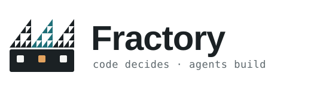
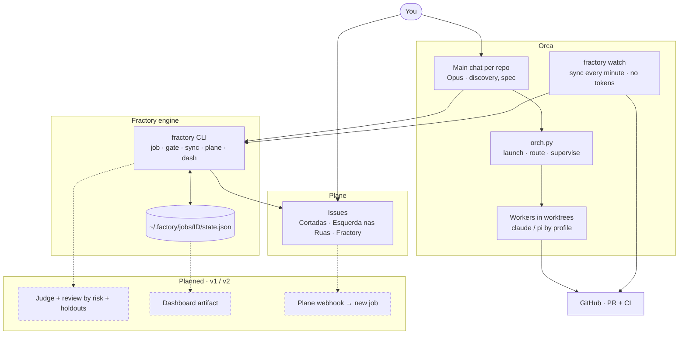

<p align="center">
  <picture>
    <source media="(prefers-color-scheme: dark)" srcset="assets/logo-dark.svg">
    
  </picture>
</p>

# Fractory

Engine and control plane of the agent factory on Orca. Code decides a job's stage, transitions,
gates and escalation; a model only works inside a stage.

Design: [Fractory — design da versão final](https://claude.ai/artifact/MaZLMg6zhgk1niVf49h5Fc).
This repo is **v0 (engine)**: the job state machine, the CLI, the Plane adapter and the import of open
specs. Building still runs through `orch.py` (passthrough, behaviour unchanged).

## Run

```sh
python3 -m fractory --help          # no install needed, stdlib only (Python 3.12+)
pipx install -e .                    # optional: a `fractory` command on PATH
python3 -m unittest discover -s tests -t .
```

## How the pieces fit today

Everything outside *Planned* runs today (v0). You pick work in Plane and talk to the repo's main chat; the CLI keeps each job's state; `fractory watch` moves jobs on CI and merges and updates Plane.



## Using it in Orca

A job's life today, with the manual steps v1 will automate marked *(manual)*.

**Once**

1. Plane token in the Keychain: `security add-generic-password -s fractory-plane -a plane -w`.
2. `pipx install -e ~/Factory/Fractory` so `fractory` works in every Orca terminal.
3. `fractory watch --install`: a LaunchAgent keeps `watch` running across reboots (log:
   `~/.factory/watch.log`). It moves jobs on CI and merge events and keeps the Plane issues in step.
4. `fractory serve --install`: a LaunchAgent keeps the board up at http://127.0.0.1:8777 (log:
   `~/.factory/serve.log`; `--port N` to change it).
   Run both installs from an Orca terminal: they copy `ORCA_USER_DATA_PATH` and `ORCA_CLI_COMMAND` into the
   agent, without which `orca` answers `runtime_unavailable` under launchd and the rework hook cannot reach
   workers (the install warns when it is unset).
5. Optional, for internal repos: `echo 'auto_merge = true' >> ~/.factory/config.toml`. Then `watch` merges
   the PR of every approved internal job once its CI is green. Able jobs never auto-merge.
   Only low-risk diffs merge; a sensitive path or a big diff (>400 lines, >12 files) opens the gate `merge_review`. Tune in a `[risk]` table.

**Per task**, from the repo's main chat in Orca (ask Claude in plain words, e.g. *"start a fractory
job for the Plane issue X"*; these are the commands it runs):

| Step | Command | Who |
| --- | --- | --- |
| 1. Pick the work | an issue in Plane, or `fractory plane add-item --project <id> --title …` | you |
| 2–4. Job, worktree, worker | `fractory launch --repo . --issue <plane issue> --project <id> --brief FILE` (title from the issue; run id from `orca_run` in `config.toml` or `--run`; `--dry-run` shows the steps; once the worker runs, it adds the owner to the card (keeping other assignees) and sets the start date if empty; first checks the brief against the card and stops if it goes beyond it, unless `--force`) | main |
| 5. Open the PR and link it | `gh pr create`, then `fractory job link <id> --worktree … --pr <n>` and `fractory job advance <id> built` | worker / main |
| 6. Checks | nothing: `fractory watch` sees CI; red goes back to build, green moves on to review | watch |
| 6b. Rework | nothing: when a job goes back to `build` (CI red, Judge rejected) the reasons are typed into the worker's terminal (`links.terminal`) through `orch.py nudge`, and the history logs `rework_sent`; with no terminal or a failed nudge a `rework_needed` gate opens. A rejection that opens `judge_rounds` waits for you | watch / judge |
| 7. Review and verdict | `fractory judge <id>` (Opus vs the Plane issue, fixed rubric; also reads `$FACTORY_HOME/jobs/<id>/brief.md` when present, default `~/.factory`, and a brief over 20,000 chars opens a `judge_error` gate); the PR's CI results go into the prompt, and a rejection whose every reason the model also lists as `unverified` becomes `approved` only when all CI checks are green (the guesses stay as notes in the comment), otherwise it stays rejected; with `auto_judge = true` in `config.toml`, `watch` runs it for every job in review. By hand: `fractory job advance <id> reviewed`, then `approved` or `rejected` | judge / you |
| 8. Merge | internal with `auto_merge`: nothing, `watch` merges on green CI; otherwise merge on GitHub (Able: open the draft PR) | watch / you |
| 9. Done | nothing: `fractory watch` sees the merge, finishes the job and moves the Plane issue to Done | watch |

**Day to day**

```sh
fractory job list            # what is open and where it stands
fractory gate list           # what waits on you (judge rounds, cost, scope)
fractory gate resolve <id> continue --note "…"    # or cancel
fractory job status <id>     # history, links, next allowed events
fractory dash                # JSON for the dashboard
```

## Jobs

State lives outside every repo, in `$FACTORY_HOME/jobs/<id>/` (default `~/.factory`):
`state.json`, plus `holdout/` for acceptance scenarios the build never sees.

```
discovery --scoped--> spec --planned--> build --built--> checks --green--> review --reviewed--> judge
                                          ^                 |red                                  |approved
                                          +-----------------+------------<rejected----------------+
judge --approved--> ship --merged (internal) | draft_pr (Able)--> done          any --cancel--> cancelled
```

| Rule | Where |
| --- | --- |
| Same check red 2x → `escalate_model` (step up via `orch.py route --escalate-from`) | `state.apply_event` |
| 2 judge rejections → gate `judge_rounds`; events refused until resolved | `state.apply_event` |
| Spend over budget (default US$ 50) → gate `cost` | `state.add_cost` |
| Able repos (under `~/Factory/Able`) end in `draft_pr`; internal ones in `merged` | `state.apply_event`, `store.repo_kind` |

```sh
fractory job new --repo ~/Factory/Esquerdalha/cortadas --title "Chat no Plane"
fractory job advance cortadas-0001 scoped
fractory job link cortadas-0001 --worktree spec-x --terminal term_… --profile backend
fractory job advance cortadas-0001 red --check lint
fractory job cost cortadas-0001 3.20
fractory gate list
fractory gate resolve cortadas-0001 continue --note "spec ajustada"
fractory judge cortadas-0001        # verdict on the PR diff vs the Plane issue; moves the job, comments on PR and issue
fractory sync                       # advance jobs from their PR and CI, mirror to Plane
fractory watch                      # sync every 60 s until stopped (--every S, --rounds N)
fractory watch --install            # the same, as a LaunchAgent that survives reboots
                                    # watch and serve exit when main moves, launchd restarts them (watch: --no-reload)
fractory dash --out /tmp/dash.json
fractory serve                      # the live board at http://127.0.0.1:8777
fractory orch alive term_…          # everything orch.py does, unchanged
```

## Web view

```sh
fractory serve [--port 8777]          # binds 127.0.0.1 only
```

A live board of every job: one column per stage (discovery … done), cancelled jobs behind a toggle. Each
card shows the job, repo, kind (Able / internal), cost against budget, judge rounds and the PR and Plane
links; a job with an open gate gets a red border with the gate reason and detail. The header counts open
jobs, open gates and total cost, with a live indicator. Cards that change column flash briefly. The page
follows `state.json` changes through Server-Sent Events (`/api/events`), reads `/api/jobs`, and is
read-only. One self-contained HTML file, no build step.

Clicking a card opens a side panel (close with Esc, ×, or a click outside) with the job's links (worktree,
terminal, branch, PR, Plane), the Judge verdicts with their reasons, a cost-over-time sparkline and the full
history as a timeline. The URL hash `#job=<id>` opens it directly and survives a reload; the panel refreshes
when the job changes. Data comes from `GET /api/jobs/<id>` (404 for an unknown or malformed id).

A collapsible activity panel (open state remembered in localStorage; a bottom sheet on phones) lists the latest
events across all jobs, newest first, plus the last 40 lines of `$FACTORY_HOME/watch.log`. `red`, `rejected`,
`gate_opened`, `rework_sent`, `merged` and `created` are highlighted; clicking an entry opens that job's detail
panel. It refreshes on every `jobs` event and every 30 s. Data comes from `GET /api/activity?limit=50` (limit
clamped to 1..200).

## Plane

API key: `$PLANE_API_KEY`, or the Keychain item `fractory-plane`
(`security add-generic-password -s fractory-plane -a plane -w`). Create the key in Plane under
Profile settings → Personal access tokens.

```sh
fractory plane projects
fractory plane import-specs --repo ~/Factory/Esquerdalha/cortadas --project <id>           # dry run
fractory plane import-specs --repo ~/Factory/Esquerdalha/cortadas --project <id> --apply   # create
```

```sh
fractory plane create-project --name Fractory --identifier FRACTORY
fractory plane add-item --project <id> --title "…" --body "markdown" --status ready [--assign-me]
fractory job new --repo DIR --title T --tracker plane --project <id> --ref <issue id>
```

Only open specs (`draft`, `blocked`, `ready`, `in-progress`, `in-review`) are imported; done ones stay in
the repo as frozen history. Each issue carries `external_id` = the spec id, so a second run reports
`exists` instead of duplicating.

## Intake

A Plane card labelled `fractory` (state Backlog or Todo) starts a job: `fractory intake` launches it
like `fractory launch`, with the card title and description as the brief plus a fixed footer (link the PR,
advance to built, worker_done), then moves the card to In Progress. A card that already has a job (any
stage, cancelled included) is never launched twice. A launch that fails prints one line and the next card
still goes.

```toml
# $FACTORY_HOME/config.toml
intake_repos = { "<plane project id>" = "~/Factory/Fractory" }   # Plane project -> repo
intake_label = "fractory"        # default
max_parallel_jobs = 3            # default; counts jobs not done or cancelled
auto_intake = true               # `fractory watch` runs intake once per round, after sync
plane_assignee = "<plane user id>"   # owner added to cards by launch and `add-item --assign-me`; default: the API key's owner (Plane /users/me/)
```

`fractory intake --dry-run` lists what would launch and changes nothing. A job that reaches done sets the card's target date to today if empty.

## Next (v1)

Holdout verifier, risk score and review by risk, `fractory watch` under
launchd, Orca native gates, and retiring the always-on orchestrator. The roadmap lives in the Plane
project FRACTORY.
